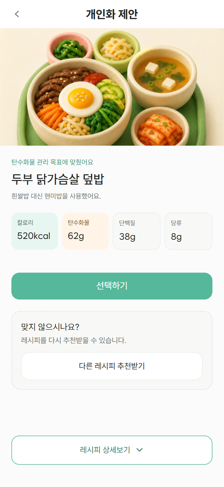
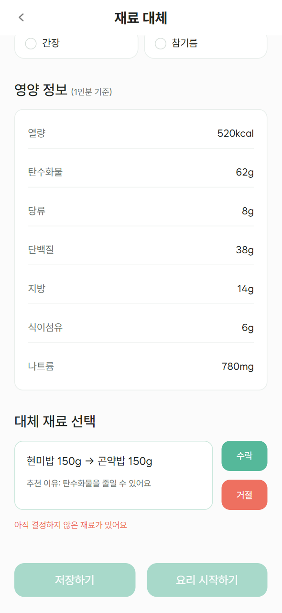
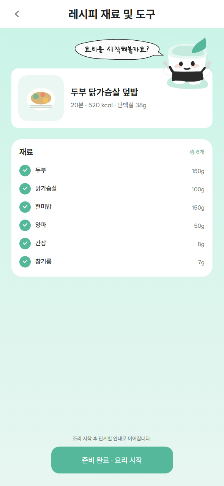

# MODI

> 가져온 레시피를 내 건강 목표와 냉장고 사정에 맞게 바꾸고, 조리까지 이어 주는 모바일 웹(PWA)

멋쟁이사자처럼 14기 해커톤 4팀 프론트엔드 · 2026.08.16 ~ 08.21 · 프론트엔드 3명

[배포 화면](https://modi-sigma.vercel.app) · [팀 원본 저장소](https://github.com/likelion-kwu/14th-hackathon-team4-frontend)

> 2026년 11월 23일 확인 기준 백엔드 서버가 응답하지 않아, 배포 화면에서 데이터가 필요한 기능은 동작하지 않습니다.

## 서비스

1. **가져오기**: 텍스트나 YouTube 링크로 레시피를 등록합니다.
2. **제안받기**: 건강 목표에 맞춘 레시피를 제안받고, 맞지 않으면 다시 추천받습니다.
3. **바꾸기**: 없는 재료를 고르면 대체 재료와 추천 이유를 보고 수락하거나 거절합니다.
4. **조리하기**: 재료를 확인하고 단계별 안내에 따라 조리합니다.
5. **돌아보기**: 식사와 외식을 기록하고 식단을 분석합니다.

## 화면

| 개인화 제안 | 재료 대체 | 조리 준비 |
| :---: | :---: | :---: |
|  |  |  |

<sub>배포된 앱에 예시 데이터를 넣어 캡처한 화면입니다.</sub>

## 본인 역할 ([leeeeeseojin](https://github.com/leeeeeseojin))

**레시피 검토부터 조리 완료까지의 흐름**을 맡았습니다.

| 영역 | 한 일 |
| --- | --- |
| 화면 5개 | 레시피 검토, 개인화 제안, 재료 대체, 재료 확인, 조리 모드의 UI와 인터랙션 구현 |
| 제안에 대한 사용자 결정 | 추천 이유 표시, 스와이프 후 수락·거절, 직접 입력 UI, 결정하지 않은 재료가 있으면 다음 단계 차단 |
| 변경 결과 확인 | 대체 재료를 수락하면 영양 정보의 전후 값을 바로 표시 |
| API | 공통 fetch 클라이언트 작성, 맡은 화면의 레시피 API 연동(팀원과 공동) |
| 프로젝트 기반 | 초기 세팅, 색상·폰트·리셋 CSS, 레시피 공통 컴포넌트, CI, 이슈·PR 템플릿, 포크 동기화 워크플로 |

로그인, 프로필, 홈, 레시피 입력·목록, 외식·식사 기록, 식단 분석 화면은 다른 팀원들이 주로 구현했습니다.

## 한계

- 직접 입력한 대체 재료는 API가 지원하지 않아 저장되지 않습니다.
- 레시피 이미지와 혈당 영향 안내 단계는 고정값입니다.

## 기술

React 19 · React Router 7 · Vite · Axios / Fetch · CSS · vite-plugin-pwa · GitHub Actions · Vercel

## 실행

```bash
pnpm install
pnpm dev
```

API 주소는 환경 변수 `VITE_API_BASE_URL`로 지정합니다.
